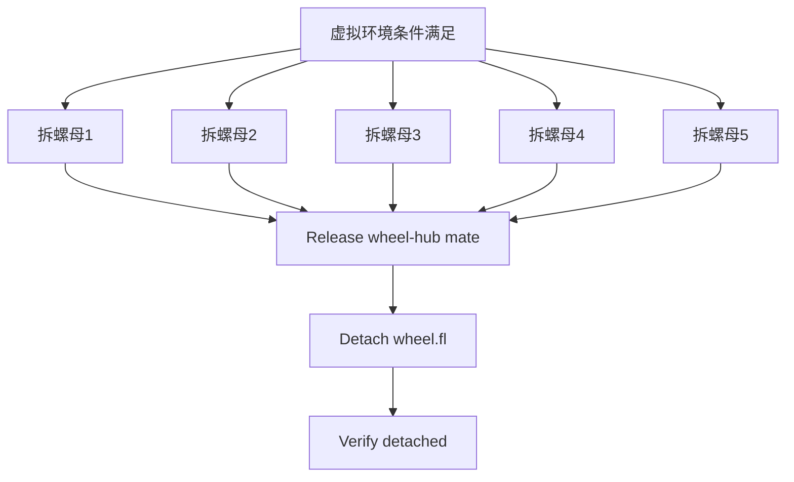

# Automotive Reference Asset Specification

> **文档 ID**：MW-SPEC-003  
> **版本**：0.1.0 (Draft)  
> **资产 ID**：`mw.car.fwd-i4.001`  
> **状态**：首个参考资产的**设计规范**；目前没有声称已经制作完成、校验通过或发布 GLB  
> **依赖**：[Mechanical Schema](./MECHANICAL-SCHEMA.md) · [Disassembly Engine](./DISASSEMBLY-ENGINE.md)

## 1. 参考车型与目的

本文件定义 Mechanical Worlds 第一个可递归拆装的车辆资产。为了保证机械关系一致，参考方案固定为：

- 一辆**概念性、非品牌的四门五座乘用轿车**；
- 前置横置直列四缸内燃机（I4），前轮驱动（FWD），手动变速箱；
- 前 MacPherson 悬架、后扭力梁悬架；
- 四轮采用轮辋+轮胎总成；制动盘、卡钳和轮毂/轴承属于**底盘**，不属于随轮胎一起取下的轮组；
- 前排两张独立座椅，后排整体座椅；
- 所有尺寸、螺纹、公差、连接角度和拆解轨迹在制作模型后由 CAD/工程资料明确提供，不能由本规范中的示意值推断为真实车型参数。

目标是在一个资产中证明完整流程：**整车浏览 → 子系统选择 → 单部件拆解 → 自动规划依赖 → 轨迹执行 → 放置 → 反向独立装配 → 完整性校验**。

这不是实际车辆维修手册。任何类似拆轮胎、拆发动机、释放弹簧的步骤都属于虚拟模型体验；现实作业必须遵循对应车型的官方维修程序、工具与安全要求。

## 2. 验收范围、能力等级及迭代

| 能力 | P0 首版要求 | P1 要求 |
|---|---|---|
| 整车 | 完整外观、六大系统、点击选择 | 细分结构与更多来源复核 |
| PartNode | 目标 ≥ 100 个可选择的物理零件实例 | 扩展到细小紧固件/内饰子件 |
| 层级 | ≥ 4 层（root→system→assembly→part） | 深层部件进一步拆解 |
| 轮组 | 四个车轮可选择；左前轮完成依赖式拆装 | 四轮都具备细化步骤 |
| 座椅 | 主驾驶座椅可递归拆/装（L2） | 滑轨与调节关节（L3） |
| 车门 | 左前门可独立展示、开启和拆装示意 | 铰链/电气连接核验（L3） |
| 发动机 | 缸体、气缸盖、曲轴、4 活塞等可探索 | 核验内部拆解顺序（L3） |
| 连接 | 至少关键用例有显式 Connector/Mate | 扩展至主要跨装配连接 |
| 路径 | P0 手工审核可执行视觉路径 | 简化碰撞与运动约束审核 |
| 视图 | 原位、透明、隔离、爆炸、重置 | 分组爆炸和零件托盘 |
| 交付 | 资产文件、元数据、报告、测试脚本 | 工程来源追溯和 Authoring Studio |

P0 的整车能力等级为**L2 Component**，可对已审核的轮组用例标注更细的局部 L3，但**不得**因为某个轮组具备 L3 就把整个汽车宣称为 L3。以下部件树表示**目标结构**，不等于已经获得对应几何。

## 3. 坐标系统与建模规范

采用 [Schema](./MECHANICAL-SCHEMA.md) 的统一坐标：

```text
车前方：-Z
车后方：+Z
车右侧：+X
车左侧：-X
车顶方向：+Y
长度：米，角度：弧度，旋转：quaternion[x,y,z,w]
```

所有轴心、紧固件中心、铰链线、滑轨方向必须在零件本地坐标系定义。具体装配 `designLocal` 来自 CAD 或作者工具，不从截图猜值。

GLB 命名准则：

- 每个独立 `PartNode` 对应一个或多个专用 glTF node；
- 同名几何可以通过 **mesh 实例化**复用，但每个物理实例拥有独立 node/binding；
- 必须保存完整原始装配姿态；
- 不得将轮胎、轮辋、制动盘和卡钳合成一个不可分离的 Mesh；
- 玻璃、线束、皮革等可视化复杂表面可由多个 Mesh 归属同一个 Part；
- CAD 装配单位从 mm 转为 m，颜色/材质/贴图不作为机械关系权威来源。

## 4. 完整目标装配树（v0.1）

下方命名约定：`fl` 左前、`fr` 右前、`rl` 左后、`rr` 右后；左/右是车辆自身视角，不是屏幕方向。`{side}` 代表**必须在发布前展开为独立 ID** 的两个或四个实例；代码块里的目录只是可阅读的结构图，而非可直接导入 JSON。

```text
vehicle  [root assembly]
├── body
│   ├── body.shell
│   │   ├── body.shell.biw                 车身焊接壳体（组合结构，P0整体）
│   │   ├── body.glass.windshield.front    前挡风玻璃
│   │   └── body.glass.windshield.rear     后挡风玻璃
│   ├── body.front
│   │   ├── body.hood.panel                发动机盖外板/主体
│   │   ├── body.hood.hinge.l              左铰链
│   │   ├── body.hood.hinge.r              右铰链
│   │   ├── body.hood.latch                盖锁
│   │   ├── body.bumper.front              前保险杠
│   │   ├── body.grille.front              前格栅
│   │   ├── body.fender.fl                 左前翼子板
│   │   ├── body.fender.fr                 右前翼子板
│   │   ├── body.lamp.head.fl              左前大灯
│   │   └── body.lamp.head.fr              右前大灯
│   ├── body.rear
│   │   ├── body.trunk.panel               后备箱盖
│   │   ├── body.trunk.hinge.l             左后备箱铰链
│   │   ├── body.trunk.hinge.r             右后备箱铰链
│   │   ├── body.bumper.rear               后保险杠
│   │   ├── body.lamp.tail.rl              左尾灯
│   │   └── body.lamp.tail.rr              右尾灯
│   ├── body.door.fl
│   │   ├── body.door.fl.shell             前左车门门体
│   │   ├── body.door.fl.glass             车窗玻璃
│   │   ├── body.door.fl.regulator         升降机构
│   │   ├── body.door.fl.motor             升降电机
│   │   ├── body.door.fl.handle.ext        外把手
│   │   ├── body.door.fl.handle.int        内把手
│   │   ├── body.door.fl.latch             门锁
│   │   ├── body.door.fl.hinge.upper       上铰链
│   │   ├── body.door.fl.hinge.lower       下铰链
│   │   └── body.door.fl.trim              门饰板
│   ├── body.door.fr                        同 fl 独立 10 Part
│   ├── body.door.rl                        同 fl 独立 10 Part
│   ├── body.door.rr                        同 fl 独立 10 Part
│   ├── body.mirror.l                       左后视镜
│   └── body.mirror.r                       右后视镜
│
├── chassis
│   ├── chassis.front
│   │   ├── chassis.subframe.front         前副车架
│   │   ├── chassis.knuckle.fl             左前转向节
│   │   ├── chassis.knuckle.fr             右前转向节
│   │   ├── chassis.hub.fl                 左前轮毂（留在底盘）
│   │   ├── chassis.hub.fr                 右前轮毂
│   │   ├── chassis.bearing.fl             左前轮毂轴承
│   │   ├── chassis.bearing.fr             右前轮毂轴承
│   │   ├── chassis.strut.fl               左前支柱总成（P0整体）
│   │   ├── chassis.strut.fr               右前支柱总成
│   │   ├── chassis.arm.lower.fl           左前下控制臂
│   │   ├── chassis.arm.lower.fr           右前下控制臂
│   │   ├── chassis.tie-rod.fl             左前转向拉杆
│   │   ├── chassis.tie-rod.fr             右前转向拉杆
│   │   ├── chassis.brake.disc.fl          左前制动盘
│   │   ├── chassis.brake.disc.fr          右前制动盘
│   │   ├── chassis.brake.caliper.fl       左前制动卡钳
│   │   ├── chassis.brake.caliper.fr       右前制动卡钳
│   │   ├── chassis.stabilizer.front       前防倾杆
│   │   ├── chassis.stabilizer.link.fl     左连杆
│   │   └── chassis.stabilizer.link.fr     右连杆
│   ├── chassis.rear
│   │   ├── chassis.axle.torsion-beam      后扭力梁
│   │   ├── chassis.spring.rl             左后弹簧
│   │   ├── chassis.spring.rr             右后弹簧
│   │   ├── chassis.damper.rl             左后减震器
│   │   ├── chassis.damper.rr             右后减震器
│   │   ├── chassis.hub.rl                左后轮毂
│   │   ├── chassis.hub.rr                右后轮毂
│   │   ├── chassis.bearing.rl            左后轴承
│   │   ├── chassis.bearing.rr            右后轴承
│   │   ├── chassis.brake.disc.rl         左后制动盘
│   │   ├── chassis.brake.disc.rr         右后制动盘
│   │   ├── chassis.brake.caliper.rl      左后制动卡钳
│   │   └── chassis.brake.caliper.rr      右后制动卡钳
│   ├── chassis.steering
│   │   ├── chassis.steering.rack          转向齿条总成
│   │   └── chassis.steering.shaft         转向传动轴
│   └── chassis.exhaust
│       ├── chassis.exhaust.front-pipe     排气前管
│       ├── chassis.exhaust.catalyst       三元催化器总成
│       └── chassis.exhaust.muffler        后消声器
│
├── powertrain
│   ├── powertrain.engine
│   │   ├── engine.block                   发动机缸体
│   │   ├── engine.head                    气缸盖
│   │   ├── engine.cover.valve             气门室盖
│   │   ├── engine.pan.oil                 油底壳
│   │   ├── engine.crankshaft              曲轴
│   │   ├── engine.piston.01              第1缸活塞
│   │   ├── engine.piston.02              第2缸活塞
│   │   ├── engine.piston.03              第3缸活塞
│   │   ├── engine.piston.04              第4缸活塞
│   │   ├── engine.rod.01                 第1缸连杆
│   │   ├── engine.rod.02                 第2缸连杆
│   │   ├── engine.rod.03                 第3缸连杆
│   │   ├── engine.rod.04                 第4缸连杆
│   │   ├── engine.camshaft.intake        进气凸轮轴
│   │   ├── engine.camshaft.exhaust       排气凸轮轴
│   │   ├── engine.timing.cover           正时机构盖
│   │   ├── engine.timing.drive           正时传动（P0整体）
│   │   ├── engine.intake.manifold        进气歧管
│   │   ├── engine.exhaust.manifold       排气歧管
│   │   ├── engine.pump.oil               机油泵
│   │   ├── engine.pump.coolant           冷却液泵
│   │   ├── engine.fuel.rail              燃油导轨
│   │   ├── engine.alternator             发电机
│   │   └── engine.starter                起动机
│   ├── powertrain.clutch
│   │   ├── clutch.flywheel               飞轮
│   │   ├── clutch.disc                   离合器摩擦片
│   │   └── clutch.pressure-plate         压盘总成
│   ├── powertrain.gearbox
│   │   ├── gearbox.case                  变速箱壳体
│   │   ├── gearbox.shaft.input           输入轴
│   │   ├── gearbox.shaft.output          输出轴
│   │   ├── gearbox.gearset               齿轮组（P0整体）
│   │   ├── gearbox.selector              换挡机构（P0整体）
│   │   └── gearbox.differential          差速器总成（P0整体）
│   └── powertrain.driveline
│       ├── drive.axle.fl                 左前半轴总成
│       └── drive.axle.fr                 右前半轴总成
│
├── wheels
│   ├── wheel.fl
│   │   ├── wheel.fl.tire                 左前轮胎
│   │   ├── wheel.fl.rim                  左前轮辋
│   │   ├── wheel.fl.valve                气门嘴
│   │   ├── wheel.fl.lug.01              螺母1
│   │   ├── wheel.fl.lug.02              螺母2
│   │   ├── wheel.fl.lug.03              螺母3
│   │   ├── wheel.fl.lug.04              螺母4
│   │   └── wheel.fl.lug.05              螺母5
│   ├── wheel.fr                          同 fl，共8个独立 Part
│   ├── wheel.rl                          同 fl，共8个独立 Part
│   └── wheel.rr                          同 fl，共8个独立 Part
│
├── interior
│   ├── interior.seat.driver
│   │   ├── seat.driver.cushion          坐垫总成
│   │   ├── seat.driver.backrest         靠背总成
│   │   ├── seat.driver.headrest         头枕
│   │   ├── seat.driver.frame            座椅骨架
│   │   ├── seat.driver.rail.l           左滑轨
│   │   ├── seat.driver.rail.r           右滑轨
│   │   ├── seat.driver.recliner         靠背调节机构
│   │   └── seat.driver.mount           车身安装座
│   ├── interior.seat.passenger             同 driver，8 个独立 Part
│   ├── interior.seat.rear
│   │   ├── seat.rear.cushion             后排坐垫
│   │   ├── seat.rear.backrest            后排靠背
│   │   ├── seat.rear.headrest.l          左头枕
│   │   ├── seat.rear.headrest.c          中头枕
│   │   └── seat.rear.headrest.r          右头枕
│   ├── interior.dashboard.panel           仪表台
│   ├── interior.dashboard.cluster         仪表总成
│   ├── interior.console.center            中控台
│   ├── interior.steering.wheel             方向盘
│   ├── interior.pedal.accelerator          加速踏板
│   ├── interior.pedal.brake                制动踏板
│   ├── interior.pedal.clutch               离合踏板
│   ├── interior.belt.driver                主驾安全带总成
│   ├── interior.belt.passenger             副驾安全带总成
│   └── interior.cabin.floor-trim           内饰地毯/地板饰件
│
└── electrical
    ├── electrical.battery                 12V 蓄电池
    ├── electrical.ecu                     发动机控制器
    ├── electrical.fusebox                 保险丝盒
    ├── electrical.harness.main            主线束（P0整组）
    ├── electrical.harness.engine          发动机线束
    ├── electrical.harness.door.fl         左前门线束
    ├── electrical.harness.door.fr         右前门线束
    ├── electrical.harness.door.rl         左后门线束
    ├── electrical.harness.door.rr         右后门线束
    └── electrical.sensor.wheel-speed      轮速传感器示意总成（P0简化）
```

**结构特殊说明**：

- 门铰链、连接件、电气插头要在 Mate Graph 中跨 `body.door.fl` 与 `body.shell` 关联；
- 主驾驶座椅与车身地板的安装紧固件在 P1 中需单独增加 PartNode；
- `engine.piston.*` 和 `engine.rod.*` 的真实装配涉及活塞销、环、轴瓦、端盖/螺栓，P0 仅用于结构学习，不允许声称可执行真实内部拆卸；
- `wheel.*.lug.*` 表示锁定轮辋的**螺母**，底盘侧轮毂承载配套螺柱几何；不能混用五螺栓型轮辋方案；
- 为减小初期复杂度，一些柔性/整体装配件明确标记 `P0整体`，后续再增加更细层级；**不能标记这些子零件已被拆解**；
- 制动卡钳/制动盘留在底盘侧，拆下 `wheel.fl` 之后仍应可见。

## 5. 关键连接图（跨子系统）

### 5.1 连接索引

每条连接关系由一对 Connector、一个 Mate 与一个 Joint（通常 fixed）形成，所有几何位置和配合公差由模型制作阶段测量。

| Mate ID | 端点 A | 端点 B | Joint | 特殊条件 |
|---|---|---|---|---|
| `mate.wheel.fl.hub` | `wheel.fl.rim` | `chassis.hub.fl` | fixed | 5 螺母紧固；拆卸前必须解除 |
| `mate.wheel.fr.hub` | `wheel.fr.rim` | `chassis.hub.fr` | fixed | 同上 |
| `mate.wheel.rl.hub` | `wheel.rl.rim` | `chassis.hub.rl` | fixed | 同上 |
| `mate.wheel.rr.hub` | `wheel.rr.rim` | `chassis.hub.rr` | fixed | 同上 |
| `mate.hub.fl.bearing` | `chassis.hub.fl` | `chassis.bearing.fl` | revolute | 轮毂绕轮轴旋转；轴承内外圈建模可深化 |
| `mate.door.fl.hinge.upper` | `body.door.fl.hinge.upper` | `body.shell.biw` | revolute / calibrated mechanism | 上下两铰链必须对齐同一旋转轴 |
| `mate.door.fl.hinge.lower` | `body.door.fl.hinge.lower` | `body.shell.biw` | supporting constraint | 实际两铰链不可当作两条彼此独立旋转轴 |
| `mate.seat.driver.rail.l` | `seat.driver.rail.l` | `body.shell.biw` | fixed | 对车身固定 |
| `mate.seat.driver.slide` | `seat.driver.frame` | `seat.driver.rail.l` | prismatic | 约束方向/行程需测量 |
| `mate.engine.gearbox` | `engine.block` | `gearbox.case` | fixed | 多紧固件，P1 细化 |
| `mate.transmission.axle.fl` | `gearbox.differential` | `drive.axle.fl` | rotational/coupling | P1 运动学细化 |

表中 `revolute / calibrated mechanism` 等为设计待定项；发布时必须转为 Schema 支持的**单一精确 Joint 类型**，不能把表格中的描述性斜杠字符串直接放进机器可读 `type`。

**轮辋拆卸并不要求先拆制动盘或卡钳**。具体车型若存在其他干涉必须依 CAD 与官方规程判断。

### 5.2 左前轮锚点

推荐使用下面的 ID：

```text
c.chassis.hub.fl.wheel-mount      (owner=chassis.hub.fl)
c.wheel.fl.rim.hub-mount          (owner=wheel.fl.rim)
c.chassis.hub.fl.lug.01 ... 05   (lug stud/fastener mount sites)
c.wheel.fl.rim.lug.01 ... 05     (bolt-hole locations)
c.wheel.fl.tire.bead             (owner=wheel.fl.tire; L2 visual only)
c.wheel.fl.rim.bead              (owner=wheel.fl.rim; L2 visual only)
```

每个锚点定义本地 `frame`、类型、直径/螺纹/间隙（若有真实资料）、验证来源。左前轮可视化拆卸外移方向大致为**车辆 -X 方向**，右侧为 +X；这只是初始路径候选，**不得代替实际碰撞扫掠验证**。

### 5.3 零件定义复用

定义 ID 示例：

```text
def.wheel.tire.generic-16
def.wheel.rim.generic-16
def.wheel.valve.generic
def.lug-nut.generic
def.seat.rail
def.door.hinge
```

`wheel.fl.lug.01` 与 `wheel.rr.lug.05` 是不同实例，但可以共享 `def.lug-nut.generic`。所有不同位置的 fastener 必须具备独立 `PartNode`、局部姿态与运行时状态。

## 6. 首批拆卸计划 A：左前轮

### 6.1 计划目标

`plan.wheel.fl.disassemble`：

- **开始条件**：参考资源已载入、相关 Part 已装配、必要环境/安全模拟标志满足；
- **目标**：轮组从 `chassis.hub.fl` 分离并移到展示托盘；制动盘、卡钳、轮毂仍与底盘侧装配；
- **验证等级**：P0 `visual`；P1 通过连接/碰撞审核后升为 `kinematic`；
- **动作**：五颗独立紧固件→解除保留连接→车轮总成外移→目标验证。

### 6.2 操作列表与 ID

| Operation ID | 动作 | 前置条件 | 结果 |
|---|---|---|---|
| `op.wheel.fl.lug.01.remove` | 移除螺母1 | 安装状态满足、虚拟支撑条件 | `wheel.fl.lug.01=placed` |
| `op.wheel.fl.lug.02.remove` | 移除螺母2 | 同上 | `wheel.fl.lug.02=placed` |
| `op.wheel.fl.lug.03.remove` | 移除螺母3 | 同上 | `wheel.fl.lug.03=placed` |
| `op.wheel.fl.lug.04.remove` | 移除螺母4 | 同上 | `wheel.fl.lug.04=placed` |
| `op.wheel.fl.lug.05.remove` | 移除螺母5 | 同上 | `wheel.fl.lug.05=placed` |
| `op.wheel.fl.release-mount` | 解除 wheel-hub Mate | 前五项全部提交 | `mate.wheel.fl.hub=released` |
| `op.wheel.fl.detach` | 外移左前轮总成 | Mate released、路径有效 | 子树轮辋/轮胎等 detached/placed |
| `op.wheel.fl.verify` | 检查组件独立 | 前一步提交 | 计划完成 |

五个螺母的操作可**逻辑并行**，但是若实际轨迹碰撞或使用同一虚拟工具资源，则自动改为串行。内部紧固件状态必须与 Mate 释放规则一致：**至少一个实际保留紧固件时不允许车轮分离**。P0 的二元 Mate 模型在最后一颗螺母移除后由 `release-mount` 将其切为 released；不表示部分拆松时已经可以分离。

### 6.3 DAG 示例



实际轮胎/轮辋分离涉及轮胎柔性形变和工具，不纳入 P0 真实机械拆卸 DAG；若需展示只使用 `L2 visual explode`，不要把两者简单直线拉开后标注为真实维修步骤。

### 6.4 轨迹设计

| Path ID | 目标 | 设计 |
|---|---|---|
| `path.wheel.fl.lug.01.out` ... `.05.out` | 五个紧固件 | 基于各紧固件的螺纹轴旋转/轴向分离（P0 演示轨迹） |
| `path.wheel.fl.out` | 左前轮整体 | 初步沿轮轴向车辆外侧移出，终点再转为托盘展示姿态 |
| `path.wheel.fl.lug.01.in` ... `.05.in` | 紧固件安装 | 独立装配轨迹，不隐式复用反向帧 |
| `path.wheel.fl.in` | 轮组安装 | 从托盘姿态进入锚点预对齐姿态 |

所有路径 `keyframes` 以 **m / s / quaternion** 编码，`referenceFrame` 显式选择 `vehicle` 或 `chassis.hub.fl`。不要把轮胎不同视觉半径的偏移写死为 0.35m；真实间距应从已导入几何测量并记录。

## 7. 首批装配计划 B：左前轮

`plan.wheel.fl.assemble` 使用**独立装配 DAG**：

1. 检查 `chassis.hub.fl`、轴承/制动盘等必要底盘状态和零件存在性；
2. 检查车轮子树完整、五个螺母都存在、未损坏；
3. 将 `wheel.fl` 对齐到 `chassis.hub.fl`，移动到预安装位置；
4. 安装第一颗螺母并建立至少一个约束连接，使轮组不再处于可自由分离的状态；
5. 依次安装其余四颗螺母；交互演示可按交叉次序播放，但不声称任何真实扭矩/紧固工艺；
6. 验证五颗螺母状态、轮辋与轮毂连接锚点对齐以及安装路径结果；
7. 提交轮组中各 Part 的 `installed`，`mate.wheel.fl.hub=locked`，目标状态通过。

为避免把二元 `Mate=locked/released` 误解成实际紧固程度，P0 **规定**：第一颗螺母完成后可以记录 `locked` 作为“分离受约束”，但整车完整装配检查必须额外验证 `fastenerCountInstalled == fastenerCountRequired`。只要五颗未全部到位，**轮组整体仍为 `placed`（未完成装配）**。

建议使用独立的最后一步 `op.wheel.fl.finalize-install` 提交 wheel subtree 的 `installed`，其前置条件包含五颗螺母均 installed，且 Mate locked。对与实际轮胎/轮毂结构不匹配的 CAD 模型，必须重建此操作计划，而不是强行套用示例。

## 8. 第二套参考计划：主驾驶座椅

首版座椅是**可解释的递归拆装**，并非完整座椅机构维修：

```text
interior.seat.driver
├── seat.driver.headrest
├── seat.driver.backrest
├── seat.driver.cushion
├── seat.driver.frame
├── seat.driver.recliner
├── seat.driver.rail.l
├── seat.driver.rail.r
└── seat.driver.mount
```

| 操作 | 目标 | P0 行为 | P1 机械增强 |
|---|---|---|---|
| 解除座椅总成固定 | 整个 `interior.seat.driver` | 外移视图，标记演示 | 真实螺栓、线束前置条件 |
| 移除头枕 | `seat.driver.headrest` | 沿头枕杆轴向上移 | 止动卡扣与释放按钮 |
| 分离靠背总成 | `seat.driver.backrest` | 遵循已标注路径 | 侧面紧固件、铰接机构 |
| 分离坐垫总成 | `seat.driver.cushion` | 视觉抬升 | 连接方式和泡沫/表皮细分 |
| 演示滑轨 | `seat.driver.rail.l/r` | 仅视觉 | Prismatic 行程限制和锁止 |

注意：具有安全气囊或座椅电气组件的现实车辆可能涉及特殊风险。参考资产在未取得相关规格之前只实现视觉操作，不提供现实拆卸步骤。

## 9. 第三套参考计划：前左车门

首版车门展示：

1. 点击车门 → 高亮该子树，显示玻璃、门锁、升降机构和内饰板；
2. 模拟铰链旋转开启（两铰链共享同一几何轴约束）；
3. 单独隐藏/展开门饰板；
4. 经过虚拟连接释放后，将门总成沿审核过的外移轨迹分离；
5. 重新对齐门框和铰链锚点，恢复原始开合关节。

不能直接将两个车门铰链分别建为两个不相关的 revolute 关节，否则可能出现运动学冲突。可以只让一个关节提供旋转自由度，另一个作为同轴对齐的支持约束/校验。

## 10. 第四套参考计划：发动机结构探索

P0 的发动机目标以**结构树、爆炸图和组件选择**为主，不声称完整真实拆卸顺序。

优先实现：

- 发动机外部总成可从整车中选中、隔离或视觉拆开；
- 4 活塞、4 连杆、曲轴、双凸轮轴能独立识别；
- 用户可以从发动机层继续进入气缸与曲柄连杆机构层；
- `gearbox.case`、`clutch`、`engine.block` 的连接关系建成跨节点 Mate；
- P1 才给真实内部路径、连杆轴瓦/端盖、活塞销、正时机构等加入可执行的工程级装配顺序。

此举是为了避免“内部零件穿过缸体漂出去”的视觉爆炸动画被误判为真实机械拆解。

## 11. 爆炸视图规格

至少支持三种**纯展示布局**：

| 布局 ID | 用途 | 规则 |
|---|---|---|
| `explode.vehicle.systems` | 六大系统 | 按车身、底盘、动力、轮组、内饰、电气分组展开 |
| `explode.wheel.fl` | 左前轮 | 轮胎、轮辋、五螺母可见；底盘侧制动系统保持在底盘分组 |
| `explode.engine.major` | 发动机 | 缸体、气缸盖、曲轴、活塞等在分组轴线上排列 |

自动爆炸可以从包围盒中心推断初始方向，但是轨迹需要美术/机械作者微调；**仅存储 view transforms**，必须通过以下不变量：

```ts
const before = deepClone(engine.getState());
viewer.setExplodedProgress(1);
viewer.setExplodedProgress(0);
assertDeepEqual(engine.getState(), before);
```

隐藏、透明、隔离、爆炸视图都不得修改 Mate 或 Part RuntimeState。

## 12. 资产包交付目录

```text
assets/mechanical/vehicles/mw.car.fwd-i4.001/
├── manifest.json
├── geometry/
│   ├── assembly.glb
│   └── collisions.glb
├── structure/
│   ├── part-definitions.json
│   ├── nodes.json
│   ├── connectors.json
│   ├── mates.json
│   ├── joints.json
│   └── fasteners.json
├── operations/
│   ├── disassembly.json
│   ├── assembly.json
│   └── paths.json
├── views/
│   └── exploded-layouts.json
├── metadata/
│   ├── bom.json
│   └── provenance.json
├── preview/
│   ├── overview.webp
│   ├── vehicle-exploded.webp
│   ├── wheel-fl-exploded.webp
│   └── engine-exploded.webp
└── reports/
    ├── static-validation.json
    ├── dynamic-validation.json
    └── render-performance.json
```

本目录是**预期交付结构**。在尚无 CAD/GLB 的情况下，不应提交内容为空的“假模型”然后宣称完成资产。当前仓库的首期交付是本文及另外两份设计规范。

## 13. 资产生产标准操作流程（SOP）

1. **定义需求**：车型拓扑、零件粒度、首版可拆装用例与验收级别；
2. **获取几何**：明确许可和来源的 CAD/STEP/原生装配模型优先；
3. **拆分物理零件**：独立可拆零件形成单独 PartNode，保持跨零件相对姿态；
4. **统一坐标**：mm→m、前向 -Z、+Y up、右手系，确认轴心/零件原点；
5. **生成 GLB**：清理冗余材质、保持可追踪 glTF node 名、生成 LOD；
6. **建立 Nodes**：Assembly Tree、复用 PartDefinitions、所有实例 ID；
7. **标注 Mate**：优先轮毂、车门、座椅、发动机关键连接，提供来源；
8. **标注 Operation**：按 `dependsOn`、guards、effects 构建拆装 DAG；
9. **标注 Path**：明确局部坐标、轴、关键帧和审核等级；
10. **静态校验**：检查全部引用、单位、层级、ID、绑定和 DAG；
11. **动态回归**：至少左前轮/座椅/车门拆装往返与爆炸视图隔离测试；
12. **性能测试**：目标浏览器交互帧率、内存、模型大小；
13. **工程复核**：没有资料支持的路径保持 `visual`，不得冒用 L3/L4；
14. **发布**：写入 Manifest 哈希、版本、质量报告、预览与变更记录。

## 14. 首版发布验收清单

### 14.1 数据和结构

- [ ] 一份 schema 兼容的 manifest，所有 hash 与 URI 可解析
- [ ] 六个一级系统节点，≥4 层装配层次
- [ ] ≥100 个可交互 PartNode（实际计数由 validator 自动输出）
- [ ] 四个独立轮组、各至少 5 颗独立螺母实例
- [ ] 左前轮轮辋、制动盘、卡钳、轮毂归属正确
- [ ] 4 活塞、4 连杆都有独立且稳定的实例 ID
- [ ] 没有多 Part 争用一个不可拆 GLB node
- [ ] 所有 source/许可/可信度信息齐全或显式标记 unknown
- [ ] 所有机器可执行关节类型符合 schema 枚举

### 14.2 操作、交互和质量

- [ ] 整车 / 子系统 / Part 可点击，高亮同步结构树
- [ ] 六大系统能够折叠展开；子装配体能够递归选择
- [ ] `plan.wheel.fl.disassemble` 前置条件不足时明确阻断
- [ ] 五颗螺母拆完之前不允许真正分离左前轮
- [ ] 拆下左前轮时制动盘、卡钳、轮毂仍留在底盘侧
- [ ] 左前轮独立装配计划完成后所有连接与紧固件状态通过检查
- [ ] 主驾驶座椅至少支持一次子级拆解与回装
- [ ] 前左车门支持关节开启演示与子组件探索
- [ ] 发动机关键零件可独立高亮、隔离和爆炸展示
- [ ] 爆炸视图不改变 `RuntimeState`
- [ ] 拆装过程任意时刻暂停/取消，不产生半提交状态
- [ ] 全部合成后选定用例位姿误差 ≤ 1e-4m / 1e-3rad（仅开发容差）
- [ ] 未经过机械验证的演示步骤在 UI 中标识 Visual / Draft
- [ ] 自动验证报告包括通过/失败项、资产版本与失败路径

### 14.3 可测性能目标（未实测）

| 项目 | 首版建议目标 |
|---|---|
| 交互帧率 | 基准桌面机器 ≥50 FPS |
| 点击零件响应 | p95 <30ms（测量具体设备） |
| 资源加载 | 输出总 GLB 字节、纹理开销与加载时长，不盲目承诺固定值 |
| 拆装稳定性 | 100 次相同轮组拆装回归后无状态漂移 |
| 状态恢复 | 随机取消、Undo/Redo 后不变量通过 |

测试脚本需记录环境信息（OS、浏览器、GPU、资产版本、渲染分辨率），且性能不达标不得修改验收阈值来掩盖问题。

## 15. 建议的 CI / 测试命令（未来接口）

以下是**建议命令**，不是当前仓库已经存在的脚本：

```bash
npm run mechanical:validate -- assets/mechanical/vehicles/mw.car.fwd-i4.001
npm run mechanical:check-dag -- assets/mechanical/vehicles/mw.car.fwd-i4.001
npm run mechanical:test-roundtrip -- --asset mw.car.fwd-i4.001 --plan plan.wheel.fl.disassemble
npm run mechanical:render-previews -- --asset mw.car.fwd-i4.001
```

报告至少写明 `assetId`、`assetVersion`、`schemaVersion`、`checkId`、`severity`、`status`、`durationMs`、`relevantNodeIds`。CI 在 fatal/error 验证失败时必须返回非零退出码。

## 16. 必须优先落地的四个垂直切片

| 顺序 | Slice | 要证明的引擎能力 | 可交付 Demo |
|---|---|---|---|
| 1 | `wheel.fl` | Connector + 紧固件 + DAG + 轨迹 + 独立回装 | 拆下五颗螺母后取轮、重新安装 |
| 2 | `interior.seat.driver` | 递归装配树 + 滑动关节预留 | 座椅整体取出，再分解头枕/靠背/坐垫 |
| 3 | `body.door.fl` | 旋转约束 + 跨装配连接 | 开关车门、独立高亮门内部 |
| 4 | `powertrain.engine` | 高层级树 + 整体/细节视图分离 | 外部总成分解+内部曲柄机构可视化 |

第一阶段优先保证**轮组演示符合状态和约束逻辑、座椅演示符合树结构逻辑**，不要一上来让所有发动机内部零件按照猜测路径拆卸。

## 17. 风险与限制

1. **几何缺失**：只有整车外观 GLB 时无法直接达到此标准，必须先获取并拆分独立零件。
2. **真实车身复杂性**：车身焊点、胶粘、排线、油液与柔性件的物理拆卸不是简单刚体动作；P0 只做明确标注的演示。
3. **结构与维修差异**：不同品牌车型的螺母/螺栓、轴承和卡钳拆卸流程不同，示例不能迁移为真实维修手册。
4. **约束精度**：连接锚点偏差如果未从可靠 CAD 来源标注，会导致吸附正确性下降。
5. **安全边界**：弹簧储能、高压电、燃油、热表面等现实危险系统不应由交互玩具提供未经核对的拆卸指引。

## 18. Definition of Done

本资产达到 **P0 可发布**的条件：几何存在且可加载、六大系统层级与独立零件满足目标、左前轮拆卸/装配用例满足依赖规则、座椅和车门用例可运行、发动机层级可探索、爆炸模式与拆装状态隔离、自动回归和校验报告通过。

达到 **P1 机械级发布**还需要：锚点与关节坐标复核、关键操作连续碰撞检测通过、紧固件/连接状态一致、更多真实机械前置条件、工程来源与审查记录齐全。

本规范是基准资产的**源头契约**。需求范围变更必须同时检查 `MECHANICAL-SCHEMA.md` 和 `DISASSEMBLY-ENGINE.md` 的兼容性。
