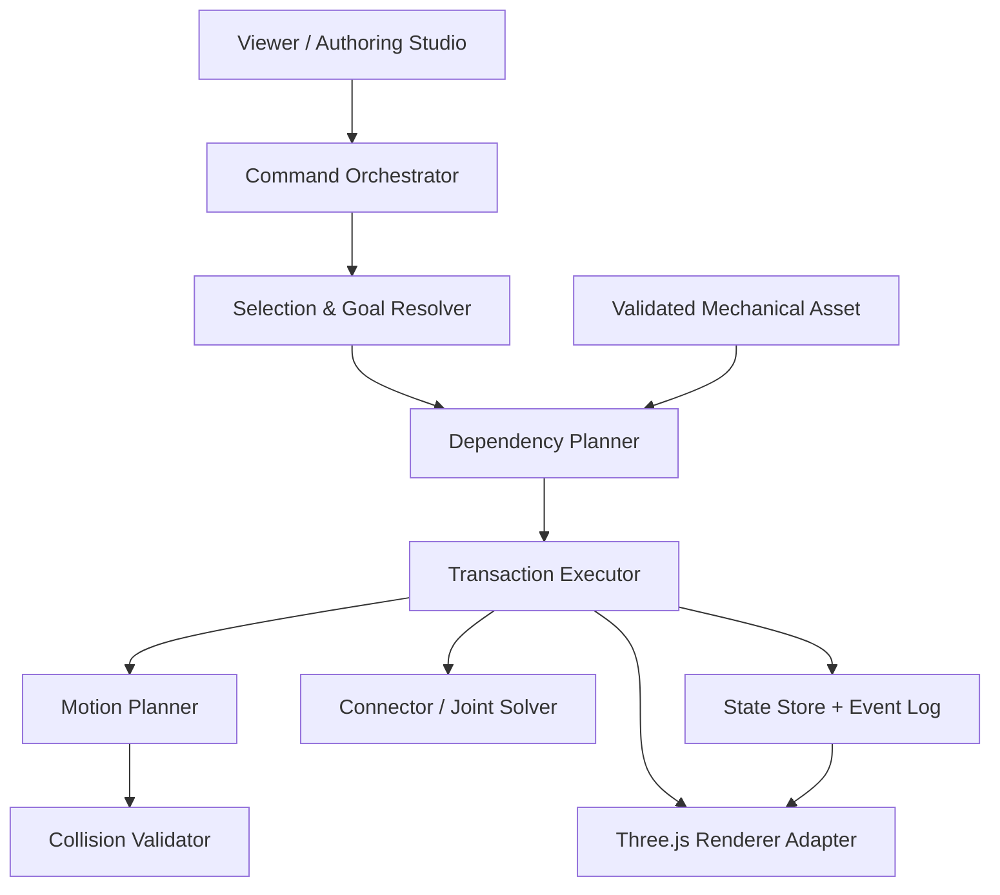
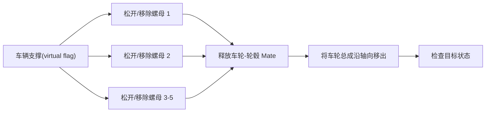
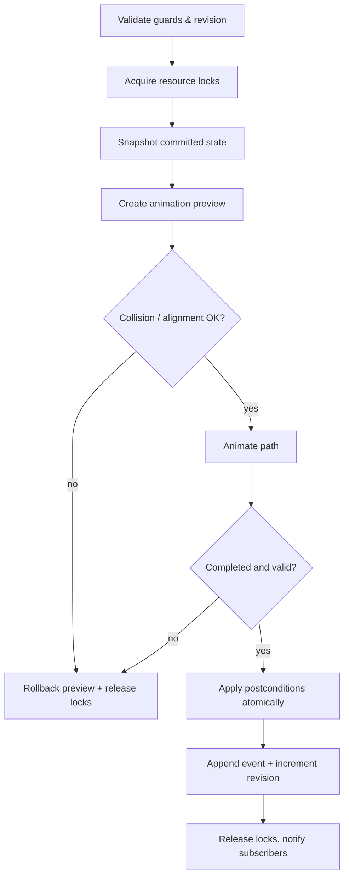

# Disassembly Engine Architecture & Execution Specification

> **文档 ID**：MW-SPEC-002  
> **版本**：0.1.0 (Draft)  
> **状态**：设计提案；算法、接口及性能目标尚未实现和实测  
> **依赖**：[Mechanical Schema](./MECHANICAL-SCHEMA.md)  
> **参考实现目标**：TypeScript Headless Core + Three.js Adapter + Node.js Validator

## 1. 目标与系统边界

引擎要回答六个问题：**能否拆？先拆什么？怎么拆？拆后系统事实是什么？中断如何恢复？如何装回去？**

一个合法的拆装操作不仅是一段视觉动画，还必须满足：

1. 前置条件有效：连接已解除、先决操作已完成、专用操作状态满足；
2. 动作计划可执行：路径起点一致，目标在允许的自由度内移动；
3. 动作结果一致：零件状态、Mate/Joint 状态、位姿和事件记录在同一提交点更新；
4. 可以暂停、取消、恢复并在可恢复失败时回滚；
5. 单次拆解、整机拆解、子装配体拆解和重装复用同一规则引擎；
6. 渲染层（Three.js）可被替换，机械事实状态不受展示变化污染。

**重要区分**：

| 模式 | 修改机械事实？ | 是否要求依赖/碰撞验证？ |
|---|---|---|
| Orbit / highlight / hide | 否 | 否 |
| Exploded view | 否 | 否；可做视觉防重叠 |
| Kinematic demonstration | 只修改运动变量 | 关节限制，可选碰撞 |
| Disassemble / Assemble | 是 | 是；按资产验证等级执行 |
| Manual drag / Snap | 成功提交后才修改 | 是；需锚点/连接验证 |

不能把 "exploded progress = 1" 当成 "all parts detached"。

## 2. 总体分层



### 2.1 Core 不得依赖渲染引擎

`packages/mechanical-core` 只依赖稳定的数学与数据抽象；不能直接持有 `THREE.Object3D`、DOM 节点或 React 组件。

- **Asset Registry**：只读机械结构、Definitions、Nodes、Connectors、Mates、Joints、Operations、Paths。
- **Graph Index**：父子索引、Mate 邻接表、operation predecessor/successor 索引、拓扑排序缓存。
- **State Store**：当前装配事实、revision、提交事件、快照。
- **Planner**：从目标与当前状态产生可执行操作序列。
- **Executor**：资源锁、guards、路径验证、动画指令、原子提交和失败回退。
- **Kinematics**：装配锚点变换、关节自由度、位置和方向容差验证。
- **Collision Service**：离线资产质量检查与运行时轨迹检查的统一接口。
- **Renderer Adapter**：纯适配层，接收视觉位姿，不决定业务状态。
- **Authoring Adapter**：把编辑器操作转成版本化资产编辑。

建议目录：

```text
packages/
├── mechanical-schema/
│   ├── types/
│   ├── validators/
│   └── migrations/
├── mechanical-core/
│   ├── asset-registry/
│   ├── assembly-tree/
│   ├── connector-graph/
│   ├── joint-solver/
│   ├── operation-dag/
│   ├── planner/
│   ├── executor/
│   ├── state/
│   └── collision/
├── mechanical-three/
│   ├── loader/
│   ├── picking/
│   ├── animation/
│   ├── overlays/
│   └── explosion/
└── mechanical-testkit/
    ├── fixtures/
    ├── invariant-checks/
    └── roundtrip/
```

## 3. 状态模型：静态定义、动态事实、临时动画

### 3.1 三层状态

```text
Design Data (immutable)
  ├── designLocal / connector frames
  ├── mate & joint definitions
  └── operation graph

Mechanical Runtime (authoritative, versioned)
  ├── actualLocal
  ├── partStatus
  ├── mateState
  ├── flags / joint coordinates
  └── revision + committed events

Presentation State (ephemeral)
  ├── selected, hidden, opacity
  ├── exploded layout & progress
  ├── preview transforms
  └── animation cursor / UI playback
```

**不变量**：视觉层的任何事件不得直接提交 `mateState` 或 `partStatus`。用户点击“确认装配”时必须发出显式 command，由 Executor 做完整验证后提交。

### 3.2 零件状态机

正常拆卸：

```text
INSTALLED
  → RELEASING     # 连接释放动画阶段
  → DETACHING     # 位移/转动执行阶段
  → DETACHED      # 提交的物理分离状态
  → PLACED        # 移至工作台/零件托盘，若提供
```

正常合成：

```text
DETACHED or PLACED
  → ALIGNING      # 锚点对齐预览
  → INSTALLING    # 路径与连接动作
  → INSTALLED     # 后置条件校验与原子提交
```

`RELEASING / DETACHING / ALIGNING / INSTALLING` 是**事务执行中的短暂运行时状态**。若动画取消，回到事务开始时最后一个持久状态；若失败进入 `ERROR`，向 UI 附上错误码并恢复有效快照，不能长期保留半锁定连接。

对应连接图：`LOCKED → RELEASING(preview) → RELEASED(committed)`；逆向合成：`RELEASED → ALIGNING(preview) → LOCKED(committed)`。不允许“部件已拆卸但必需连接仍 locked”的不一致状态。

### 3.3 子装配体整体拆卸

一个 assembly 节点本身不一定存在 Mesh。拆下它时：

1. 对该 assembly 子树计算群组运动变换；
2. 保留子树内部的 locked 连接；
3. 只解除**跨边界** Mates（一个端点在子树内，另一个在子树外）；
4. 子树下各物理 Part 在当前世界位姿上接受群组相同的刚体变换；
5. 运行时显式记录子装配体 `detached` 聚合状态或由边界连接和成员状态派生；不允许与成员 Part 状态相互矛盾。

对于可自由移动的已拆下子树，建议在运行时维护 `detachedGroupPose`，而非修改原设计树的父节点。

## 4. 命令协议与 API

命令代表用户意图，不是对场景对象的直接操作：

```ts
type Command =
  | { type: "DISASSEMBLE"; targetNodeId: string; planId?: string }
  | { type: "ASSEMBLE"; targetNodeId: string; planId?: string }
  | { type: "EXPLODE"; layoutId: string; progress: number }
  | { type: "RESET_VIEW" }
  | { type: "PAUSE"; executionId: string }
  | { type: "RESUME"; executionId: string }
  | { type: "CANCEL"; executionId: string }
  | { type: "UNDO" }
  | { type: "REDO" }
  | { type: "DRAG_PREVIEW"; partId: string; desiredWorldPose: Transform }
  | { type: "SNAP_COMMIT"; partId: string; targetConnectorId: string };

interface MechanicalEngine {
  load(asset: ValidatedAsset): Promise<void>;
  dispatch(command: Command): Promise<CommandResult>;
  getState(): Readonly<RuntimeState>;
  subscribe(listener: (event: EngineEvent) => void): () => void;
  listValidActions(targetNodeId: string): AvailableAction[];
}
```

`dispatch` 对长时动画返回一个 `executionId`/可查询状态，或在应用层返回 Promise；不应阻塞渲染主线程。Command IDs 应支持去重，避免双击触发同一个拆装操作。

**用户交互语义**：

- `DISASSEMBLE(vehicle)`：选择已有整机计划，或在界面允许后将可执行操作按拓扑层展开；
- `DISASSEMBLE(wheel.fl)`：先计划必要前置操作，不得直接忽略仍 locked 的螺母/连接；
- `ASSEMBLE(wheel.fl)`：从当前已拆状态推导装配条件，不能不验证就反转动画；
- `EXPLODE`：改变 ViewState，机械 RuntimeState revision 保持不变；
- `UNDO`：根据事务/快照恢复，并生成新的历史变更记录，而不是直接倒放一段动画。

## 5. 依赖图、计划与可执行性

### 5.1 Operation DAG

每个 `OperationPlan` 对应一个有向无环图 `G=(V,E)`，其中边 `a → b` 表示**a 必须提交成功后才能执行 b**。

规则：

- Graph 加载时必须拒绝缺失操作节点、自环或有向环；
- 同一拓扑层中操作**可能**并行，但必须再经过资源锁、路径体积和业务效果冲突检查；
- 业务前置条件以 `preconditions` 表达，不能仅依赖边连接；
- `plan.goalPredicates` 满足才算完成，不以动画时间结束作为完成标准。



现实维护中，松开车轮螺母和抬升/支撑车辆的次序取决于具体车辆与安全规程；上图只是交互式虚拟模型的**逻辑依赖演示**，不得当作现实维修流程。

### 5.2 计划生成

`plan(goal, state)`：

1. 查询资产已声明的可支持 plan，检查目标类型和资产能力等级；
2. 从 `goalPredicates` 与当前状态计算缺失效果；
3. 反向追溯能提供效果的 operations 与 `dependsOn`；
4. 解析显式安全 predicates；缺失的条件不能无理由合成，必须通过合法操作或外部授权标志提供；
5. 通过拓扑排序生成候选执行层；
6. 对同层操作按 `resourceLocks` 和空间扫掠包围体划分并行批次；
7. 预检路径起点、接触面豁免、碰撞风险和可回滚性；
8. 生成计划摘要：预计操作数、所需资产、不可执行原因、验证等级；
9. 在版本锁定 (`assetVersion` + `state.revision`) 后开始执行。

规划失败必须返回结构化障碍列表，例如 `BLOCKED_BY_LOCKED_MATE`、`MISSING_PART`、`UNVERIFIED_PATH`，而非仅提示“操作失败”。

伪代码：

```ts
function buildPlan(goal: Goal, state: RuntimeState): PlannedExecution {
  const candidates = findOperationsForGoal(goal);
  const required = dependencyClosure(candidates, state);
  assertAcyclic(required);

  const layers = topologicalLayers(required);
  const batches = layers.flatMap(layer => partitionByConflicts(layer, state));

  for (const batch of batches) {
    validateGuards(batch, state);
    validatePaths(batch, state);
  }
  return freezeExecutionPlan(batches, state.revision);
}
```

注意：上面的 `validateGuards` 实现必须基于逐层**模拟预期未来状态**，不能错误地拿初始 state 校验所有后续步骤；真实代码应使用 `projectedState` 逐步应用效果后再验证下层。

### 5.3 计划的部分执行

用户暂停于第 n 步时，已经提交的步骤保留；当前未提交的运动预览取消/暂停后可重演。继续执行时：

- 检查最新 `state.revision`；
- 若存在外部变更，则重规划剩余动作；
- 不重复执行已提交的幂等操作；
- 若资源被锁定，给出等待/冲突提示而非并发覆写。

## 6. 事务执行：提交与回滚

### 6.1 原子操作生命周期



运行时不得先把 `mateState` 设置为 released、动画失败后却忘记改回来。建议实现**暂存态**与**已提交态**双缓冲：

- 动画改变 preview transforms；
- 业务效果暂存到 `pendingTransaction`；
- 动画完成后做最终 guards 与几何检查；
- 单次原子提交 `effects + actualLocal + event + revision`；
- 失败取消 preview，回到 snapshot；
- 同一 plan 内并行操作只在写集不冲突时允许；需要整体原子性时使用批事务。

```ts
type Transaction = {
  id: string;
  operationId: string;
  startingRevision: number;
  readSet: string[];       // nodes, mates, flags
  writeSet: string[];
  checkpoint: RuntimeState;
  proposedEffects: OperationEffect[];
  previewTransforms: Record<string, Transform>;
  status: "preparing" | "previewing" | "committing" | "committed" | "rolled-back";
};
```

**资源锁排序**：跨对象锁按规范化 ID 排序取得，避免死锁。若碰到资源重叠，同层操作改为串行。运行中应限制并发预算，避免大量 Mesh 同时进入高成本精细碰撞。

### 6.2 事件与快照

每次 commit 产生可审计事件：

```json
{
  "eventId": "evt-0000128",
  "type": "OPERATION_COMMITTED",
  "executionId": "exec-wheel-fl-01",
  "operationId": "op.wheel.fl.detach",
  "assetVersion": "0.1.0",
  "revisionBefore": 127,
  "revisionAfter": 128,
  "timestamp": "2026-11-18T00:00:00Z",
  "affectedNodeIds": ["wheel.fl"],
  "result": "ok"
}
```

`timestamp` 在这里是结构示例值，不声称实际执行过该操作。事件应该携带能够重建状态的确定性效果或 snapshot 引用；仅凭这个摘要 JSON 不足以真正重放。

建议事件日志每 N 次提交做快照，回放时校验资产版本、事件版本、起始 revision 和前置条件。播放帧时间不是状态确定性的来源。

## 7. 一键拆解、合成与撤销

### 7.1 一键拆解

一键拆解不是让所有子节点径向展开。其执行过程：

1. 识别用户选择的 assembly subtree；
2. 查找该子树相关的被声明为可执行的拆卸计划；
3. 计算所有跨边界 Mate 及必要紧固件；
4. 按当前状态补全需要的 operations；
5. 按拓扑层执行；逐步提交；
6. 对尚不能真实拆卸的内部组件保留原位置并展示能力级别；
7. 形成可浏览的零件托盘/工作台视图（展示变换可与物理分离状态区分）。

计划可支持 `stopAtDepth`、`excludeCategories`、`stepMode`、`maxConcurrent`，默认应在 UI 显示拟拆卸范围及是否包含不可逆紧固件。

### 7.2 合成

**合成规划是独立的图**：

- 每个安装动作必须具有独立前置条件和安装后置条件；
- 除非已提供经过验证的 inverse operations，否则不得仅反转动画；
- 安装末端执行锚点定位、姿态容差、连接锁定；
- `Mate` 从 released → locked 时验证紧固件已安装；
- 已损坏或一次性耗材必须有替换件，无法按原样复原时明确拒绝“全部恢复”。

对 L2 演示资产可使用 `visual` 验证级的简化合成，但不能标记为真实机械级 L3/L4。

### 7.3 Undo/Redo

Undo 是**业务操作**，不是把 `t` 从 1 调到 0：

- 若操作具有已验证 `inverseOperationId` 且当前状态满足条件，优先执行逆操作；
- 纯仿真/编辑场景允许恢复已持久化快照，但必须检测是否有后续依赖事务；
- 当当前结构已改变、后续操作依赖被破坏时，要求先撤销依赖者；
- Redo 是对同一资产版本、同一受支持状态重做原操作；
- 不允许强行“恢复物理上不可逆的零件”而不提示用户。

## 8. Connector 与 Joint 解算

### 8.1 配合定位

源锚点局部变换 `C_s`，目标锚点 `C_t`，目标 Part 世界变换 `T_wt`，Mate 定义的偏移 `M`：

```text
T_ws_target = T_wt × C_t × M × inverse(C_s)
```

执行器在世界系求得目标位姿，再转换到源零件装配父系的 `actualLocal`。对具有旋转对称/滑移自由度的 Joint，产生的是**一组合法解**，而不是唯一姿态，应通过当前姿态最小改变量、行程边界、接触面等约束选解。

### 8.2 可验证条件

- 所有 Mates 的 connector 关联实例存在且可用；
- 轴线归一化；
- 方向/法向量和手性正确；
- 轴心/面距离满足零件公差；
- Joint 限位不被越过；
- Fastener 状态与锁定 Mate 一致；
- 连接操作不与另一个 active transaction 写入同一状态。

示例状态返回：

```ts
type SnapPreview = {
  candidateMateId: string;
  targetWorldPose: Transform;
  translationErrorM: number;
  angularErrorRad: number;
  allowed: boolean;
  blockers: ValidationIssue[];
};
```

UI 可以用绿色/黄色/红色显示几何匹配与异常，但**颜色不是机械安全认证**。

## 9. 路径规划、碰撞和空间约束

### 9.1 策略顺序

建议从可靠性高到低分层：

1. **工程审核的手工轨迹**：首选，关键车型/机械优先；
2. **CAD 推导的运动自由度**：关节轴、安装方向、拆卸端面等；
3. **约束下自动生成的简单轨迹**：轴向平移、绕轴转动、螺旋退出；
4. **启发式候选路径**：多段 waypoint、A* / RRT 之类的几何路径搜索；
5. **无法保证可行时人工标注**：标记不可执行，不得放行碰撞路径。

并不要求 v0.1.0 实现完整自动路径搜索；P0 可以只实现人工轨迹与线性扫掠检测。

### 9.2 碰撞检查层次

| 层级 | 实现思路 | 用途 |
|---|---|---|
| Broadphase | AABB / OBB / 空间索引 | 筛掉大量不相交对 |
| Midphase | Convex hull / convex decomposition | 常规可移动部件 |
| Narrowphase | BVH/triangle mesh | 复杂、审核必要的轨迹 |
| Continuous | swept volume / 连续碰撞近似 | 避免高速动画“穿透” |

每段路径需要在运动的多个时间点及扫掠体上验证，而不是只比较起点/终点。要明确**允许接触对**和 `clearanceM`：滑轨滑动、轴承配合、螺栓孔内接触本来就可能被一般碰撞算法误报。

碰撞过滤必须随连接状态改变；已拆卸部件与仍连接的相邻零件不应始终排除，尤其不能用“同一装配体”粗暴关闭所有碰撞。

### 9.3 失败回退与审查等级

对于 `collisionPolicy="required"` 的路径，任何无法确认的扫掠碰撞都会阻断提交；`advisory` 可以继续视觉演示，但需要显著标识**未经过工程碰撞审核**；`none` 仅适合仅展示模式。

`Visual correctness ≠ kinematic correctness ≠ engineering correctness`。成功渲染不能自动升级资产等级。

## 10. Three.js 运行时与动画协议

### 10.1 渲染器职责

`mechanical-three` 负责：

- GLB/glTF 节点装载与 `PartNode.geometryBindings` 绑定；
- Raycasting 或 GPU picking → `partId`；
- 可见性、高亮、选择盒、连接锚点/关节轴 Gizmo；
- 爆炸视图与独立拆装预览；
- 动画插值和镜头跟踪；
- 将 Core 产出的 `RenderSnapshot` 映射为 Scene Object3D；
- LOD/压缩纹理/懒加载，不改变业务节点身份。

唯一数据传输协议建议为：

```ts
type RenderSnapshot = {
  revision: number;
  objects: Record<string, {
    worldPose: Transform;
    visible: boolean;
    opacity: number;
    highlight?: "selected" | "candidate" | "warning";
  }>;
};

interface MechanicalRendererAdapter {
  mount(asset: ValidatedAsset, canvas: unknown): Promise<void>;
  render(frame: RenderSnapshot): void;
  dispose(): void;
}
```

Frame 被发布时，Core 仍是机械事实状态的唯一权威；Three.js 只把当前已提交状态及动画预览插值成可见对象。

### 10.2 确定性动画

- 使用单调逻辑时钟/显式播放时间，支持 pause/seek/step；
- quaternion 使用 slerp，平移使用有界插值，避免欧拉万向锁；
- “按时间求姿态”，而非每帧无限累加 delta，防止浮点误差漂移；
- 动画只提供可视回馈，提交逻辑仍由 Executor 的成功信号控制；
- 拆装取消时丢弃 preview transforms，恢复已提交 snapshot；
- 相机/缩放/拖拽不应导致 operation 被执行两次。

**爆炸算法**单独作为 view projection：根据装配体包围盒、中心与布局规则生成 `explosionDelta`。不写入 `actualLocal`，不变更 `mateState`，不增加 runtime `revision`。

## 11. 性能与可观测性

性能目标是**待测验收阈值**，不代表已达成：

| 场景 | 建议初始目标 | 测试条件 |
|---|---|---|
| 100–150 个可交互 Part | 桌面交互 ≥ 50 FPS | 中档桌面 GPU、基准场景 |
| 单次 Raycast 选择 | p95 < 30 ms | 目标测试机器 |
| 100 个节点结构校验 | < 200 ms | Node.js 本地执行 |
| 单次常见轮组计划生成 | < 100 ms | 已缓存 Graph Index |
| 单次零件位姿回装误差 | ≤ 1e-4 m / 1e-3 rad | 相同资产版本及数值环境 |
| 爆炸视图切换 | 机械状态不变 | 严格断言 |

应监控 `operation_duration_ms`、`planner_duration_ms`、`collision_checks`、`failed_guard_count`、`rollback_count`、`render_frame_ms`、`asset_load_ms`、`memory_usage`。日志引用 ID 不应包含敏感用户信息。

## 12. 测试矩阵

### 12.1 单元测试

| 模块 | 最少覆盖 |
|---|---|
| Tree | 深度递归、重复 ID、孤儿、环 |
| Connector | 位姿变换、反向法线、对称轴、尺寸冲突 |
| Joint | 固定/旋转/滑动的许可自由度与限制 |
| DAG | 环检测、缺失引用、拓扑序、并行冲突 |
| Operation | guards、effects、幂等、缺失目标 |
| Motion | t 单调、起点匹配、取消/seek/slerp |
| State | revision CAS、原子提交、事件重放、快照恢复 |
| Explosion | 0→1→0 不更改物理状态 |

### 12.2 集成测试：轮组案例

用 [Automotive Asset Specification](./AUTOMOTIVE-ASSET-SPEC.md) 中的左前轮测试：

1. 初始 `mate.wheel.fl.hub=locked`；
2. 直接移动车轮必须失败或自动规划先决动作；
3. 已知紧固件先后关系满足后才可 release mount；
4. release 后车轮总成可以沿审核过的路径离开；
5. 制动盘和制动卡钳**保持在轮毂/转向节所在的底盘侧**；
6. 拆完后支持独立爆炸视图，且该视图不改变刚提交状态；
7. 依据装配 plan 恢复锚点和紧固件；
8. 最终所有被测试的姿态与连接回到初始状态；
9. 在任何单一操作动画中取消，状态必须恢复到该操作开始前的快照。

### 12.3 异常与恢复

- 路径被遮挡 → 报告 collision + 不提交；
- 动画中断 → 无脏状态；
- 同一个按钮双击 → 幂等去重；
- 两个操作争抢同一 bolt → 锁冲突，串行化；
- 计划执行中资产升级 → 拒绝继续或经迁移/重规划；
- Undo 时存在依赖后续步骤 → 返回 blocker；
- 任意子装配体全部合成后，根节点连接图仍一致。

## 13. 风险清单

| 风险 | 影响 | 缓解 |
|---|---|---|
| 导入 GLB 只有外壳，没有真实 Part | 不能进行真实拆装 | 建立 CAD 优先准入与人工 Part segmentation |
| 自动车轮/齿轮拆解轨迹穿模 | 误导用户/破坏体验 | 审核轨迹 + swept collision |
| 把 Mesh 层级当装配关系 | 子装配体逻辑错误 | `Node` 与 GLB node 分离 |
| 简单倒放装配动画 | 忽略锁扣/紧固件/替换件 | 独立 assembly plan 与 guards |
| 运行时/视图状态混用 | 爆炸视图破坏状态 | 双层状态模型 + 不变量测试 |
| 不可逆零件无法原样回装 | “一键全部合成”失真 | expendable fastener 标记 + replacement 条件 |
| 机械规格缺乏依据 | 真实性风险 | 来源、审核级别、免责声明 |

## 14. 研发阶段与 Definition of Done

### P0 — Deterministic MVP

- Asset Registry、树索引、基本 Part State Store；
- Operation DAG 规划与 guards/effects；
- 单实例与组件级拆装，明确的 `Visual` 验证等级；
- 固定的手工路径、动画预览与原子提交；
- 取消、重置、快照、基础 Undo；
- Three.js 适配器支持 picking、层级展开、爆炸视图；
- 左前轮和驾驶座椅两个垂直切片可完成拆装往返测试。

### P1 — Mechanical interaction

- Mate/Joint 真正的对齐与连接求解；
- Fastener 实例级管理；
- Geometry collision checks；
- Manual drag/snap commit；
- 并行步骤安全调度、事件重放；
- 编辑器中的可视化路径和连接点 Gizmo。

### P2 — Production authoring & scale

- CAD 来源/装配关系导入；
- 多机械资产验证；
- 仿真结果和 CI 报告；
- 启发式自动路径建议（人审）；
- 大规模资产 LOD 与内容寻址发布。

**完成标准**：任何资产仅当其被宣称的能力等级对应所有校验通过时，方可发布。最小 P0 必须支持：零件选择 → 依赖规划 → 动画 → 提交 → 取消/回滚 → 正确重新合成，并用自动化测试证明静态/动态状态不变量。

下一步参考：[Automotive Asset Specification](./AUTOMOTIVE-ASSET-SPEC.md) 的整车范围、真实连接边界和首版验收清单。
