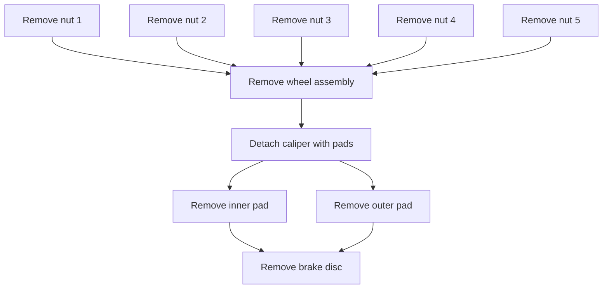

# Four-Corner GLB Mechanical Contracts (P1b Conceptual)

This file records the currently implemented mechanical operations on **actual named GLB Part nodes** in the first generated automotive batch. It is an interactive software reference, **not a service manual or safety-certified mechanic simulator**.

## Data sources

- Geometry source: `assets/generated/automotive/fwd-i4-batch-01.glb`
- Ground-truth node identity/translation: `assets/generated/automotive/manifest.json`
- Runtime constraint generator: `packages/mechanical-core/src/automotive-corners.ts`
- Mechanical engine: `packages/mechanical-core/src/index.ts`
- Exported machine-readable runtime contract: `models/automotive-corners-contract.json` in the built GitHub Pages output
- Browser: `automotive.html` and `src/automotive.ts`

A new binding is only valid when a node ID matches the corresponding catalog Part ID and its actual GLB node. The original fixture still exists as a separate P1 test; this new fixture is tied to the **real generated GLB assets** instead of placeholder procedural scene objects.

## Four mechanically addressable corners

`FL` left-front, `FR` right-front, `RL` left-rear, `RR` right-rear each include:

- Hub, wheel rim, tire and valve;
- 5 individually removable wheel nuts (20 across all corners);
- Rotor, caliper, inner and outer brake pad;
- A fixed rim/hub Mate, 5 nut/rim Mates, and rotor/hub, caliper/hub, and pad/caliper Mates.

The full GLB scene still includes 76 Part nodes, but only the 4 selected wheel/brake corners support these new assembly plans. Other chassis/structure objects remain geometry-only.

## Mechanics inventory

| Category | Status |
|---|---|
| Four independent corner operation namespaces | implemented |
| 5 independently removable lugs per corner | implemented |
| Rim/hub fixed Mate & per-nut Mate | implemented |
| Rotor/caliper/pad conceptual Mates | implemented |
| Wheel removal and wheel reinstall | implemented |
| Wheel + brake removal and reinstall | implemented |
| Joint/connector position reconstruction | implemented |
| Engine state transaction, cancel and rollback | implemented |
| Authoring provenance per Mate tolerance | `conceptual` |
| Continuous swept collision / OEM clearance | **not implemented** |
| Actual wheel nut torque/thread pitch | **not verified** |

## Dependency workflow



A separate installation DAG returns the brake disc, pads, caliper and wheel to initial positions, then restores the lugs. Mechanical Core checks operation dependencies and target states before committing; pads can be moved after caliper removal without invalidating the earlier caliper-removal dependency.

## Connector reference frames and tolerance evidence

Connector positions are derived from the **committed GLB manifest's design translations**, not from hypothetical world locations disconnected from rendering.

For FL, for example:

```text
hub = position("chassis.hub.fl")
rim = position("wheel.fl.rim")

rim.connector.local = hub - rim
hub.connector.local = [0, 0, 0]

T_world_rim × C_rim ~= T_world_hub × C_hub
```

All Mates use local `Transform` frames and are checked in world space. The current conceptual software acceptance limits are:

- positional agreement: `<= 0.001 m` (1 mm, **not a manufacturer tolerance**);
- angular agreement: `<= 0.02 rad` (software orientation agreement, **not a production fit tolerance**);
- evidence: `conceptual` (all current GLB parts);

`Mate.verified = true` here means the **runtime software checks calculated frames on lock**, not that an engineer has reviewed the physical fit. A distinct `tolerance.evidence = "cad-reviewed"` is permitted only with a source identifier. Real CAD review must come from licensed documentation and inspection.

## Motion and collision

- Lug actions have explicit staged screw-like rotations and axial displacements. The turn count is illustrative.
- Wheel group moves along the generated axle's local outward direction. Rotor and caliper remain attached to chassis unless brake-service plan is requested.
- Caliper removal moves its still-mounted pads with it; pad release occurs afterward. Reinstalling pads while the caliper is displaced uses matching local frames; installation subsequently brings the group back.
- Swept checking currently uses **discrete AABB samples**, with specific known assembly-contact exclusions for wheel insertion. This does not prove a real mounting path collision-free. All brake-specific paths use advisory collision status.
- A virtual vehicle-support flag is a software guard, not a real-world safety requirement verification.

## Regression gates

`tests/generated-corners.test.mjs` covers:

- Source-linked GLB node names and all Mate initial alignment checks.
- 4 × wheel removal/reinstallation round trips, including chassis brake components staying installed during wheel removal.
- 4 × brake-service removal/reinstallation round trips, including disc, caliper, and inner/outer pads.
- Negative guards for premature caliper/rotor removal and cancelled fastener transaction rollback.
- Lock restoration and zero-offset final state.

`tests/contracts.test.mjs` additionally validates the generated, machine-readable operation and anchor export.

## Engineering next stages

1. Replace conceptual proxy boxes with collision shapes derived from licensed CAD/STEP geometry, keeping the original source.
2. Fit-independent pin, bolt, flange and bracket Mate definitions with true fastener properties.
3. Add angular and translational DOF solvers for steering, knuckles and suspension arms.
4. Replace hardcoded demonstration motion parameters with validated path authoring and swept collision.
5. Add simulator safety-critical gating for load-bearing brakes and suspended assemblies.

Until then, the tool is valuable for **teaching program architecture, machine-assembly state logic, asset pipeline and visualization**, but must not be used as a real automotive disassembly procedure.
