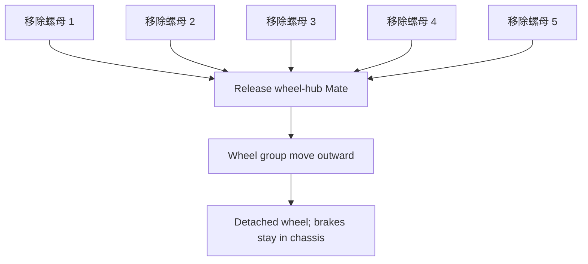

# P1 Mechanical Assembly Implementation — Wheel & Eyeglasses

> 文档版本：0.2.0（可运行 P1 垂直切片）  
> 代码状态：已接入仓库，并由 GitHub Actions 执行类型检查、Node 自动化测试与 Vite 构建。  
> 注意：本文包含**演示模型的真实运行能力**，不等价于真实车辆或商用眼镜的 CAD/维修验证。

## 1. 目标与范围

围绕两项独立机械参考模型：

1. 汽车左前轮：五颗可单独操作的螺母、轮毂 Mate、可分离轮辋/轮胎总成、底盘侧制动盘/卡钳、原位装回；
2. 机械眼镜：左右镜片、鼻托、铰链座、镜腿及螺钉，镜腿绕铰链销轴开合并有角度限制；

加入 P1 能力：

- 有稳定 ID 的**局部连接锚点**；
- 基于世界坐标姿态的 Mate 配合检查与吸附目标计算；
- **Revolute** 铰链约束（初始角、角度范围、支点和轴）；
- 螺纹件的**先旋出/旋入、再进入/离开零件托盘**的分段路径；
- AABB 碰撞代理与按时间采样的轨迹预检；
- 计划依赖、状态事务、回滚、装配验收、浏览器端 3D 动画；
- 可搜索的完整车辆结构**规划目录**（不是已完成 3D 资产）。

## 2. 模块结构

```text
packages/
├── mechanical-schema/src/index.ts
│   ├── MechanicalAsset / Nodes / Connector / Mate
│   ├── RevoluteJoint
│   ├── MotionPath（linear/screw/hinge）
│   ├── CollisionProxy
│   └── validateAsset()
├── mechanical-core/src/
│   ├── index.ts         # 事务状态机 + DAG + 防重 + undo/redo + path preflight
│   ├── p1.ts            # math, connectorPose, mateAlignment, snapPosition, collision
│   ├── fixtures.ts      # P0 基本操作图与实例
│   └── p1-fixtures.ts   # P1 几何锚点、关节、路径和代理
└── mechanical-three/src/index.ts
    ├── 鼠标拾取 / 模型显示
    ├── getPartPose() 绑定关节动画
    └── 螺钉旋转、透明镜片、爆炸视图
assets/catalog/automotive-fwd-i4-001.json
tests/
├── engine.test.mjs
├── p1.test.mjs
└── catalog.test.mjs
```

Core 负责事实状态，Renderer 只接收派生姿态。`explosion` 不改变任何 Mate/Joint/Part 状态。

## 3. P1 锚点设计

每个 Connector 的 `local.position` 和 `local.rotation` 是**所属 Part 的局部坐标**。车轮示例：

```text
chassis.hub.fl       designPos = [0.00, 0.30, 0.00]
  connector.mount    localPos  = [0.00, 0.00, 0.00]

wheel.fl.rim         designPos = [-0.38, 0.30, 0.00]
  connector.mount    localPos  = [+0.38, 0.00, 0.00]
```

两个连接锚点的世界坐标均为 `[0, 0.30, 0]`。

通用目标位置：

```text
targetWorldPose = T_world_targetPart × C_target × M × inverse(C_source)
```

本期实际实现 `snapPosition()` 计算源零件的**平移目标**，假设当前旋转和配合偏移适用；更完整的六自由度吸附求解（含方向/配合偏移/尺寸公差）属于后续阶段。

`mateAlignment()` 计算两端距离和四元数角差。演示采用 **15 mm / 0.03 rad** 的固定阈值，目的仅是检测本项目程序化几何中的位置偏差；真实 CAD 资产必须通过连接类型和厂家公差表给出自己的限值，**不得沿用演示阈值**。

## 4. 左前轮拆装状态

### 4.1 拆卸 DAG



“虚拟支撑标志”是演示中的 guard，不是现实维修许可。真实车辆的维修工艺和安全次序须以车型资料为准。

### 4.2 轴向旋出 + 放入托盘

每个螺母的 `MotionPath` 包括：

- `kind: screw`；
- `axisWorld`（轴方向）；
- `turns`（演示旋转圈数）；
- `axialTravelM`（螺旋运动阶段沿轴位移）；
- `screwPhaseFraction`（这一阶段占总动画的比例）；
- `collisionPolicy` 与 `ignorePartIds`（演示零件托盘排除规则）。

拆卸：

1. 前半段沿轴向旋出、位移；
2. 后半段停止旋转，向展示位置移动；
3. 只有动画完成且校验通过才提交 `detached`。

安装：

1. 先从托盘靠近安装点；
2. 后半段按独立安装路径旋入；
3. 最后一颗螺母及必要 Mate 条件成立后才确认整个轮组安装完成。

`turns` 和轴向距离是程序演示的参数，不是任何特定车的实际螺纹螺距、拧紧扭矩或安全规程。

### 4.3 正确零件边界

拆下车轮总成时随行的零件：轮辋、轮胎、气门嘴。五颗螺母已经单独拆下。

**不会随车轮移动**：底盘轮毂/轴头、制动盘、制动卡钳。

## 5. 眼镜铰链约束

两组关节采用独立 `RevoluteJoint`：

```text
joint.g.temple.left
  drivenPartId: g.temple.left
  pivotWorld: [-1.37, 0.65, 0.12]
  axisWorld:  [0, 1, 0]
  limits:     [-0.78, 0] rad

joint.g.temple.right
  drivenPartId: g.temple.right
  pivotWorld: [1.37, 0.65, 0.12]
  axisWorld:  [0, 1, 0]
  limits:     [0, +0.78] rad
```

上述数值是**当前程序化参考眼镜局部几何**，不是市场眼镜的实际尺寸。

旋转时，受驱动镜腿的姿态由当前关节角 `θ` 决定：

```text
P_world(θ) = Pivot + Quaternion(axis, θ) × (P_world(0) - Pivot)
Q_world(θ) = Quaternion(axis, θ) × Q_world(0)
```

镜腿打开后如果尝试拆卸螺钉，操作前置条件将拒绝，因为 `jointAngle != 0`。用户须先闭合，再执行拆装计划。关节动画没有改变其它被锁定的零件状态。

## 6. 碰撞预检与限制

P1 提供一个可复用的简化 `CollisionProxy`：每个 Part 有本地中心和半尺寸，运行时将其转成随姿态更新的世界 AABB。

检查过程：

1. 读取操作的 `MotionPath`；
2. 构造动画前后状态；
3. 在轨迹上分配固定数量的采样点（默认 24，轮组 36）；
4. 对每个采样位置计算所有运动代理与非运动代理的 AABB 重叠；
5. 根据 `collisionPolicy` 决定阻断或报告；
6. 对原本已经存在的接触配合做显式排除。

### 严格限制

这**不是**连续碰撞检测，也不是精细 Mesh/BVH 碰撞；如果两个碰撞发生在相邻采样点之间，可能漏报。系统当前还会排除**起点时已经重叠**的代理对，这避免了简单模型中的合法装配接触误报，但可能漏掉同一对零件后续的危险交叉。

部分眼镜柔性/卡扣/镜片动作是 `advisory` 模式，不阻断。车轮参考演示的指定运动路径启用了 `required`；但**所使用的仍是简化代理，不代表已获得制造精度的碰撞安全验证**。

后续优先替换：

- 按实际 CAD 几何自动提取 convex hull / decomposed colliders；
- Swept volume / continuous collision detection；
- 专用接触白名单（Mate/Joint 解除前后动态变化）；
- 多自由度路径优化与人工复核；
- 单位正确的尺寸/形位公差表。

## 7. 数据完整性与自动验收

所有 `Operation` 先验证 guards 与依赖，再执行碰撞预检，动画阶段只改变 preview，最后进行原子提交；失败不应该留下半完成的业务状态。

自动化验收覆盖：

- Schema、装配树、Operation DAG；
- 五颗螺母移除前，不得拆卸左前轮；
- 轮毂锚点必须对齐，回装位置精度一致；
- 两侧镜腿开/合角度满足限位和铰链轴；
- 打开的镜腿不得直接拆铰链螺钉；
- 眼镜全部拆卸 / 装配后 Part、Mate、offset 复原；
- 人工构造的障碍导致 `required` collision 预检失败；
- 故意损坏的锚点在锁定 Mate 时被拒绝；
- 螺钉预览真实包含分段轴向运动与旋转；
- 浏览器与 Node 使用相同类型和 Headless Core。

运行：

```bash
npm install
npm run test
npm run build
npm run dev
```

CI 结果查看 [Mechanical Worlds Actions](https://github.com/1998x-stack/Mechanical-Worlds/actions)。

## 8. 整车资产库扩展（清单级）

`assets/catalog/automotive-fwd-i4-001.json` 定义：

- 六大一级系统：Body、Chassis、Powertrain、Wheels、Interior、Electrical；
- 42 个 Assembly Node（含根节点和子装配体）；
- 317 个 Part 实例层级规划条目；
- 每个条目带稳定 `id`、`parentId`、中文名称、`kind`、`geometryStatus` 和工程审核字段。

所有零件目前标为 `geometryStatus:"planned"`、`engineeringVerified:false`。这是对后续**完整汽车资产生产任务**的可追踪拆分，尚无 317 个可拆的汽车 Mesh。浏览器提供一个可以搜索和筛选的规划目录。

下一阶段可按此 catalog 自动生成工作清单，并从有许可的 CAD/STEP 装配导入逐项替换规划条目；凡是缺乏真实物理零件与连接锚点的条目，不应自动升级为 L3 Mechanical。

## 9. 尚未完成 / 后续里程碑

| 优先级 | 工作项 | 当前状态 |
|---|---|---|
| P1a | 装配局部锚点 + 对齐检测 | 已实现参考案例 |
| P1a | 眼镜 Revolute Joint + 动画 | 已实现参考案例 |
| P1a | 紧固件分段螺旋轨迹 | 已实现参考案例 |
| P1a | AABB + 离散采样碰撞 | 已实现参考案例（演示级） |
| P1b | 六自由度人工拖拽吸附 | 未实现 |
| P1b | 真实螺纹、制造公差和紧固工具 | 未实现 |
| P1b | 连续扫掠碰撞 / BVH | 未实现 |
| P1b | 眼镜镜片柔性卡扣 / 真实力学 | 未实现 |
| P1b | 317 个汽车零件的来源合规真实 GLB | 规划目录已建立；模型未制作 |
| P2 | 机械 Authoring Studio + 自动 CAD 导入 | 未实现 |

## 10. 可信度声明

本系统旨在展示可审计的数据建模、规则执行和 3D 交互机制。**本次 P1 验收仅保证逻辑、数学变换及程序化示例在自动化测试条件下运行**；不代表真实机械维修流程已被证明正确或安全。

对于汽车制动、安全带、座椅气囊、电气、高压、弹簧储能和其他安全关键部件，必须使用经过权利确认、工程审核的专用资产与规程。
